# Automate process flows — current implementation

Reviewed 2026-09-14; behavior layer updated to manifest **4.7.0**. Clinical workflow branches below remain the source-review baseline. Static source review; no live automation or clinical transaction was executed. Diagrams describe implemented behavior, including failure branches, rather than intended behavior. View with a Mermaid-capable Markdown preview.

## Behavior update: 4.7.0

Settings use independent tab profiles in PC-local Chrome storage. New/duplicated tabs start independently; reload and Chrome session-token restoration recover the same tab settings. No settings are written to the shared folder or Chrome Sync. Runs wait for pending settings restoration.

All six active panels retain their original DOM nodes while running, even off their normal routes or after DOM removal. They stay expanded with Stop available; Close/Minimize and popup dismissal are blocked during runs. Full page reload still ends an in-memory run. IP Fill mode cannot be changed by route detection during a run.

Image fallback downloads bind filename and URL in one request; the shared next-download filename slot has been removed.

## Inventory and run conditions

| Process | Trigger and conditions | Source |
|---|---|---|
| Auto Allocate | Workbench button; correct route; no other workbench task running | content/automation.js:767 |
| Auto Dispense | Separate workbench button; same shared running guard | content/automation.js:767 |
| IP Fill | Run button; idle; at least one ward selected; IP Fill mode | content/ipfill_panel.js:788 |
| POM IP Fill | Same engine, POM mode and routes | content/ipfill_panel.js:11 |
| Auto override | Enabled preference; matching alert dialog appears; handler not busy | content/auto-override.js:447 |
| Drug image collection | Start on Item Master; idle; localhost medication DB available | content/drug-image.js:737 |
| Image flag synchronization | Sync button; image module idle; DB and image file list available | content/drug-image.js:669 |
| Frequency Master export | Start from Frequency Master panel; idle | content/frequency-master.js:334 |
| Order Item instructions export | Start; idle; medication DB contains codes | content/order-item.js:358 |
| HIS Translation API export | Start; idle; API mode selected, the default | content/translation.js:1020 |
| HIS Translation DOM export | DOM selected or API startup failure | content/translation.js:1078 |
| Translation enrichment helper | Programmatic enrichExport(payload); nonempty rows; captured authentication | content/translation.js:1439 |
| HM workstation | Not loaded by manifest; Start only writes a placeholder message | content/hmr.js:330 |

All active content scripts match https://arcusair.bdms.co.th/*. Relevant route plus saved dismissal state controls panel visibility. Opening a panel does not start its batch. Each module has its own running flag; Allocate and Dispense share one flag. No extension-wide lock exists. Auto override can remain active independently of batches.

## 1. Startup, routing and popup

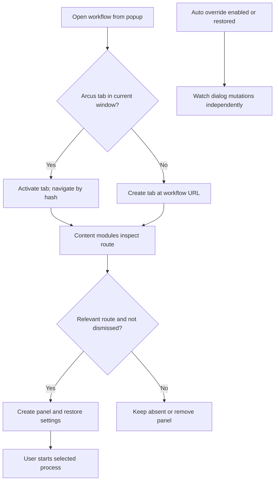

Source: manifest.json, popup.js, content/boot.js and each panel's init function. Generic workbench route matching uses the entire pharmacy workbench prefix, so IP Fill start pages also match it. Panel dismissal is separate from Stop.

Translation popup additionally checks panel presence up to 3 times. If its content script is missing, it injects CSS and API/driver/shared/translation dependencies, retries after 500 ms, then either closes the popup or reports the observed route/dependency/dismissal problem. Other popup controls mainly dispatch show/remove events. Diagnostics, log copying and endpoint detection are manual support controls.

## 2. Allocate and Dispense eligibility

| Gate | Auto refresh-search mode | Semi-auto mode |
|---|---|---|
| Allocate status | Column 8 equals Ordered, case-insensitive | No status gate |
| Dispense status | Column 8 equals Allocated, case-insensitive | No status gate |
| IPD order number | Column 10 begins I, case-insensitive | No number gate |
| OPD order number | Column 10 begins O or E, case-insensitive | No number gate |
| IPD type | All, Daily Order, Continuous Order, Discharge Medication | Same filter; recognized row required |
| OPD type | All, STAT, ROUTINE | Same filter; recognized row required |
| Multiple types | OR; All overrides other selections | Same |
| Selection | Refresh then first eligible rendered DOM row | Snapshot matching visible rows once |
| No rows | Scan up to 8 seconds; wait 30 seconds; repeat | No rows found; return |
| End | Stop/error or 500 search loops | Stop or end of snapshot |

Pharmacy type: explicit preference, otherwise detected page label/URL, otherwise inpatient. Prefix checks do not validate the complete order number. Semi-auto is not limited to rows manually checked by the user: it snapshots rows matching its filters.

Sources: shared.js:289–424, shared.js:1059–1096, automation.js:190–330.

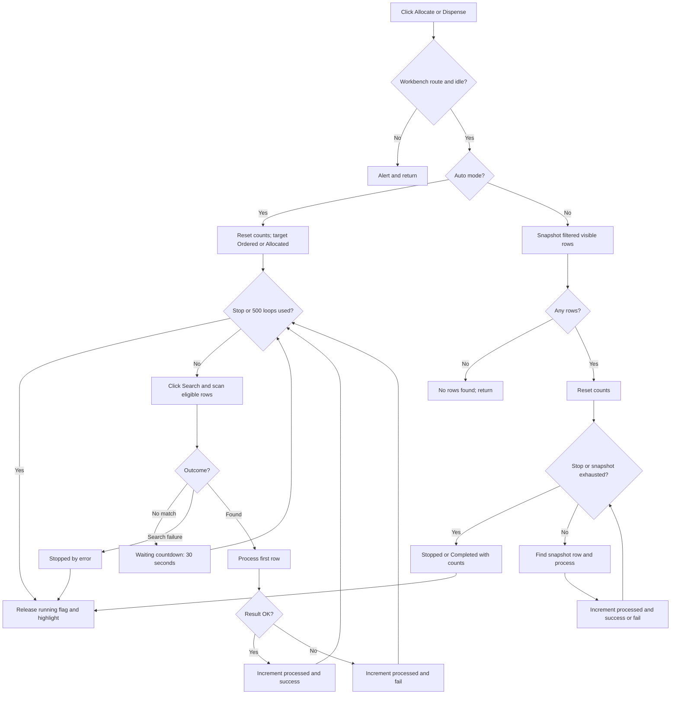

Auto failures at row level normally continue refreshing. A persistent failed row may be selected repeatedly. Search-level failure stops without incrementing row fail count. Reaching 500 loops releases the flag but has no explicit Completed status. Empty searches consume loops too.

## 3. Per-row Allocate / Dispense and re-confirmation

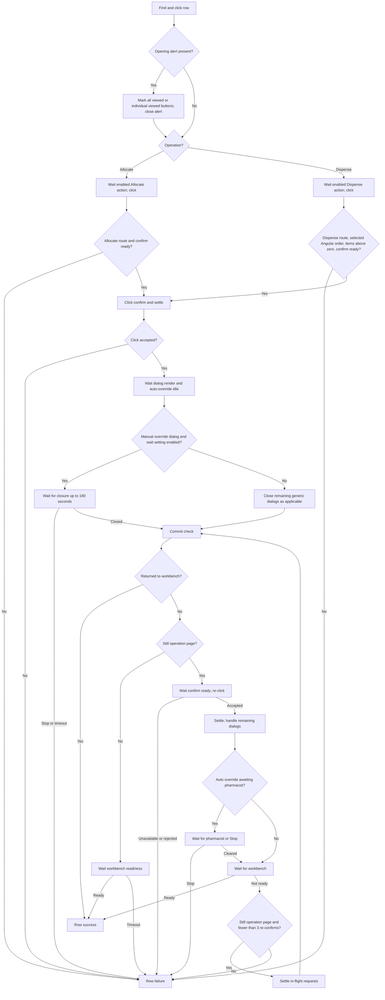

Routes: Allocate uses #!/pharmacy/allocatedispense; Dispense uses #!/pharmacy/dispensetodept. Action wait ceiling 18 seconds; route wait 20 seconds; save settle 15 seconds. Dispense additionally checks the page controller has a selected order and nonzero item count before allowing confirm.

Re-confirmation allows up to three additional presses after the initial confirm. Success is inferred from return/readiness, not an independent backend status read.

Semi-auto permits up to 3 attempts for Allocate action/route failures and synchronous exceptions in its per-row block. It does not retry every returned save failure. Snapshot matching falls back exact text → containment → original row index, which can identify a different row after changes.

Sources: automation.js:332–643, shared.js:810–1017.

## 4. Automatic override and manual waiting

Default disabled. Default reason: Medically needed. DOM observer debounce: 250 ms. It is not restricted to a running workbench batch.

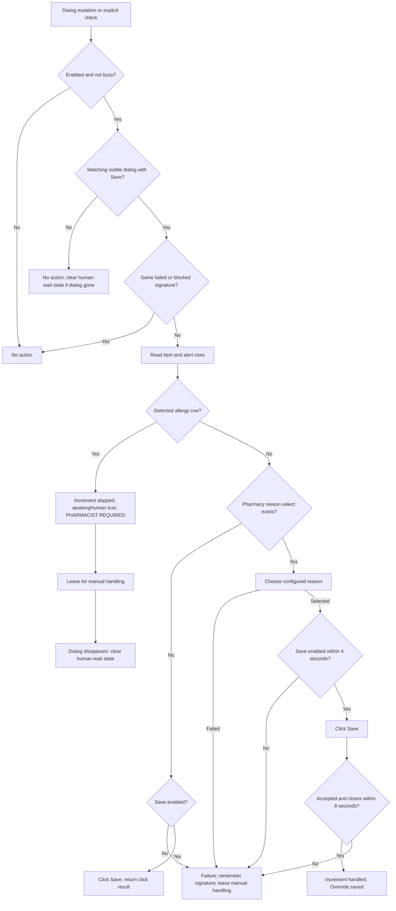

Allergy detection: applied drugallergybackground class, inline cell color containing 246,172,172, or English text matching drug allergy / allergy interaction / allergic. The declared alert-type constant is not directly evaluated by detection.

Reason selection: use existing desired value, otherwise open its own select menu up to 3 attempts, match exact text then substring, wait for interactivity, click and verify a displayed/nonempty value. Missing/disabled menu, absent option, unapplied value or Save failure leaves manual handling. No-reason Save branch does not verify closure or increment handled.

**Integration gap:** shared alert acknowledgement and generic-close helpers do not consult the allergy guard. Re-confirmation calls close helpers before checking awaitingHuman. Therefore the module's allergy exclusion is not an end-to-end guarantee that every helper leaves an allergy dialog open. The specialized pharmacist wait is indefinite until cleared/Stop; the ordinary manual override wait is 180 seconds.

Sources: auto-override.js:110–568; shared.js:871–1017; automation.js:431–440.

## 5. IP Fill and POM IP Fill

| Mode | Start route | Detail route |
|---|---|---|
| IP Fill | #!/pharmacy/dispenseworkbench/pharmacy/ipfill | #!/pharmacy/ipfilldetail |
| POM IP Fill | #!/pharmacy/dispenseworkbench/pharmacy/pomipfill | #!/pharmacy/pomipfilldetail |

Same algorithm, saved mode and selected wards. URL synchronizes mode. Ward options: Cardiac Care Unit, Intensive Care Unit, Labour Room, Neonatal Intensive Care Unit, Nursery, WARD 4–9.

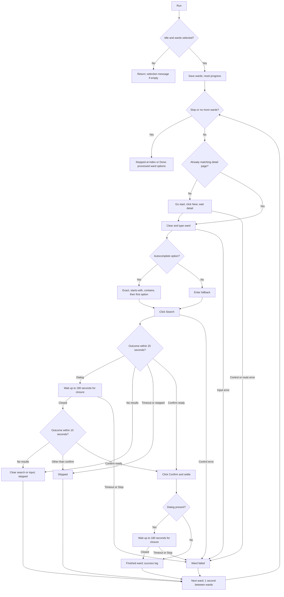

Search outcome priority: Stop → dialog → no results → confirm. A second pre-confirm dialog is skipped, not recursively awaited. Reset failure still advances. Confirm click result and committed state are not validated; no post-alert re-confirmation exists here. Final Done counts attempted ward options, including skipped/failed ones. Sources: ipfill_panel.js:574–831.

## 6. Drug image collection

Dependencies: localhost:8765 /api/medication-db, /api/med-images-list, /api/med-images/{filename}. List route #!/inventories/itemmaster; detail #!/inventories/itemmasterdetail.

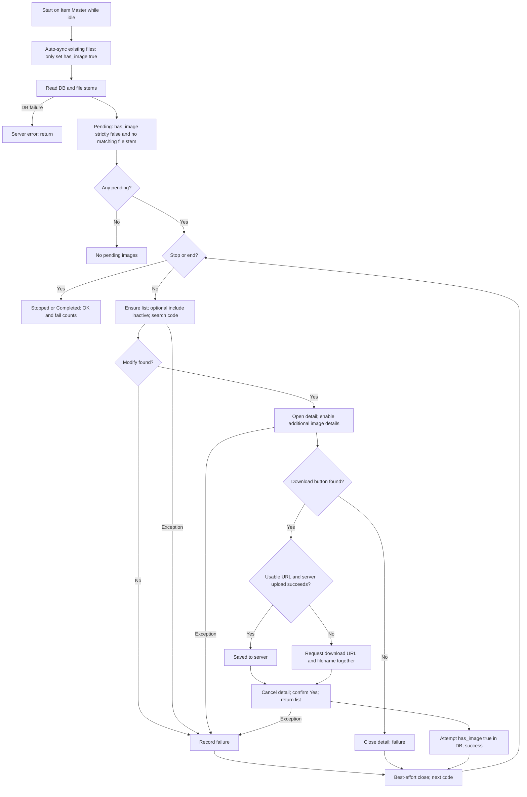

File-list failure during pending selection is treated as an empty list. Browser fallback reports success after triggering download, not completion. markImageDone does not propagate unsuccessful DB writes. Source: drug-image.js:385–794, background.js.

## 7. Explicit image flag sync

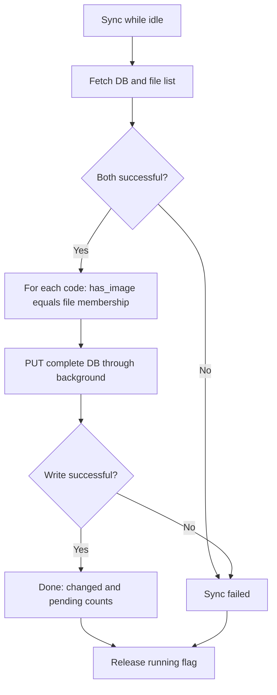

Explicit Sync can set true to false; automatic pre-run sync only sets true. Explicit sync does not check Stop in its loop. Source: drug-image.js:669–733.

## 8. Frequency Master export

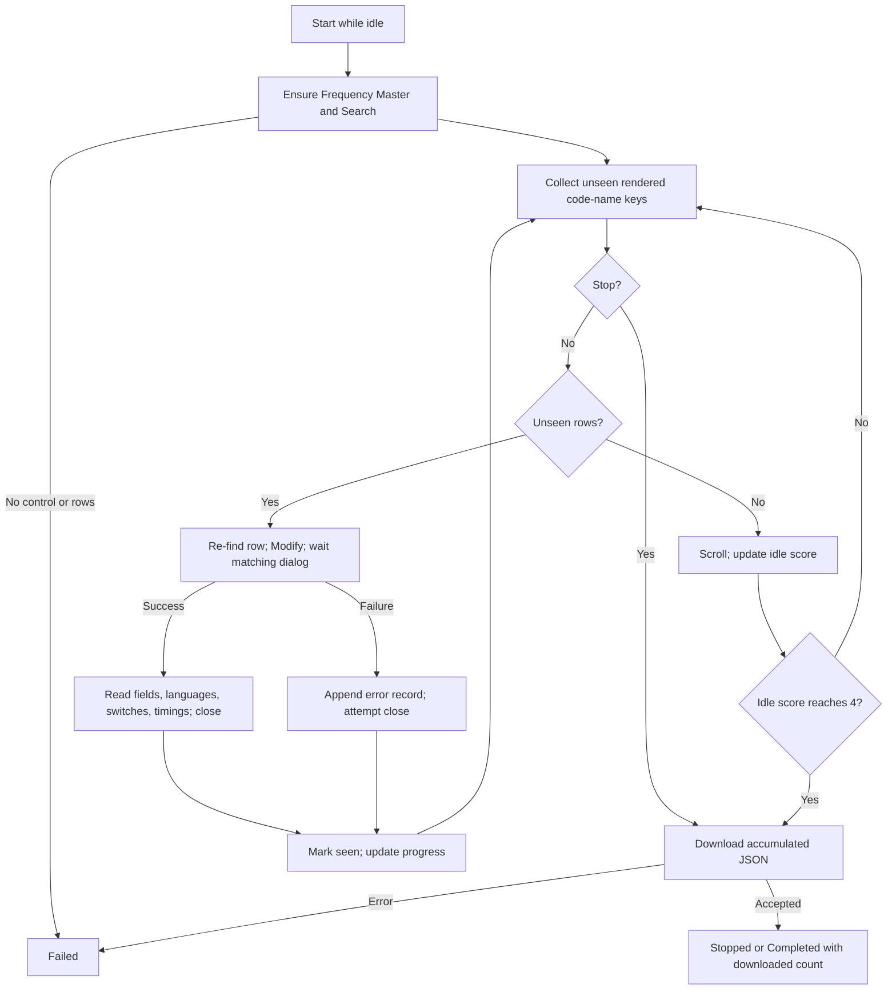

Route #!/ordermanagement/frequencymaster. Output frequency-master-{timestamp}.json. Idle score adds 1 if scroll moved or more-data hint exists, otherwise 2; resets when pending rows exist. Row errors are exported and marked seen, without retry. Outer fatal error does not automatically export partial data. Source: frequency-master.js:247–405.

## 9. Order Item instruction export

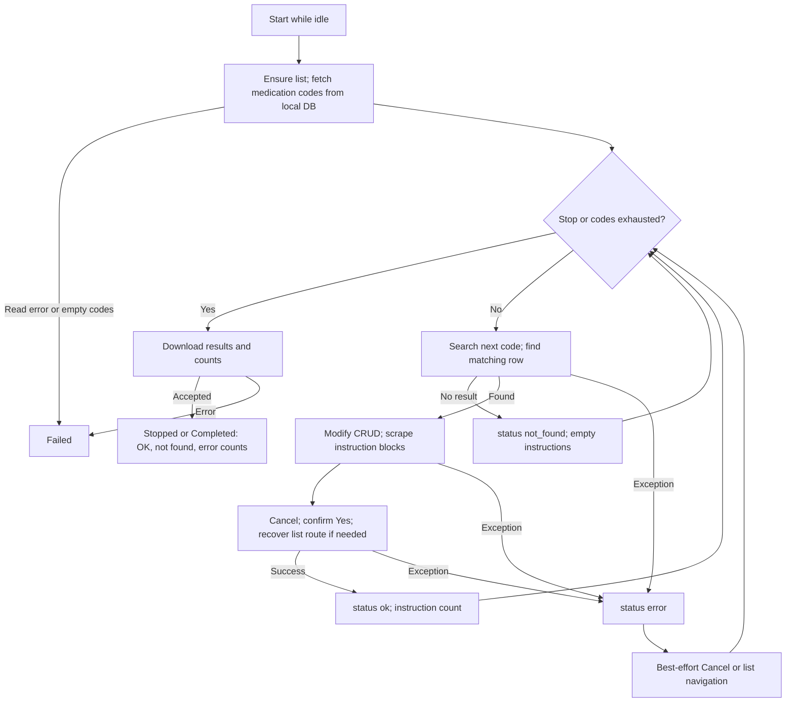

Route #!/ordermanagement/orderitem with /crud for detail. Output order-item-instructions-{timestamp}.json. Status ok means successful scrape/return, and may contain zero instructions. Source: order-item.js:120–432.

## 10. HIS Translation API and DOM export

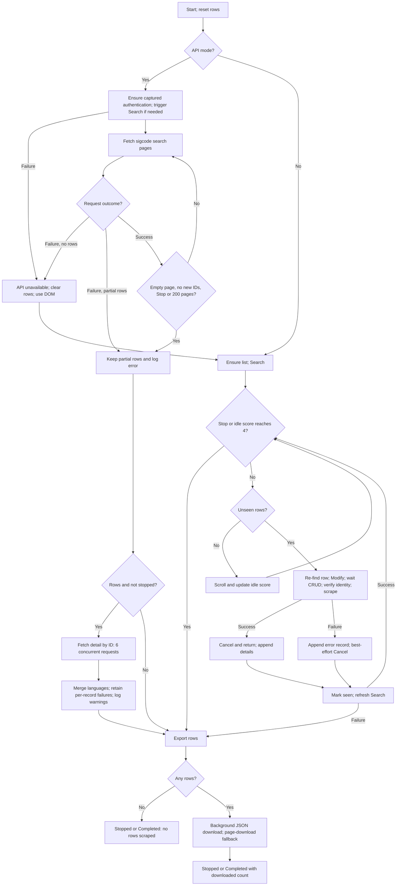

Route #!/ordermanagement/translation, CRUD suffix /crud. Search: /ordermanagement/sigcode/search with code/name empty, all=true and includeall=true. Detail: /ordermanagement/translation/getdetail/{id}. Output his-translations-{timestamp}.json.

Pagination deduplicates by _id or serialized record. A partial API failure with rows does not trigger DOM fallback. Detail failures, fewer rows than visible UI, or no local-language text can still end as Completed. DOM idle scoring matches Frequency Master. DOM refresh failure returns rows for export.

Unexpected outer failure attempts partial export in finally if rows exist and export was not attempted. The exported flag is set before final download, so that guard does not retry a failed final download. Source: translation.js:945–1137, api-client.js:241–313.

### Separate translation enrichment helper

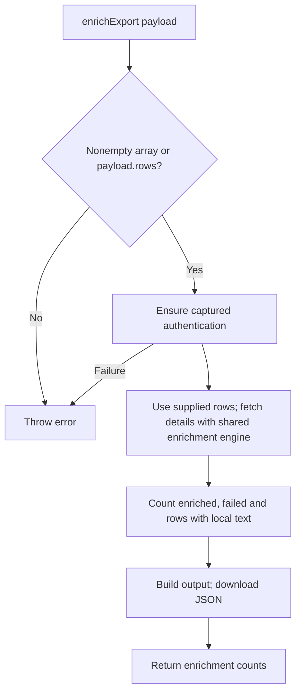

This enriches supplied records rather than discovering the full list. It shares module state and has no runScraper-style running guard. Source: translation.js:1439.

## 11. Shared driver, API bridge and background

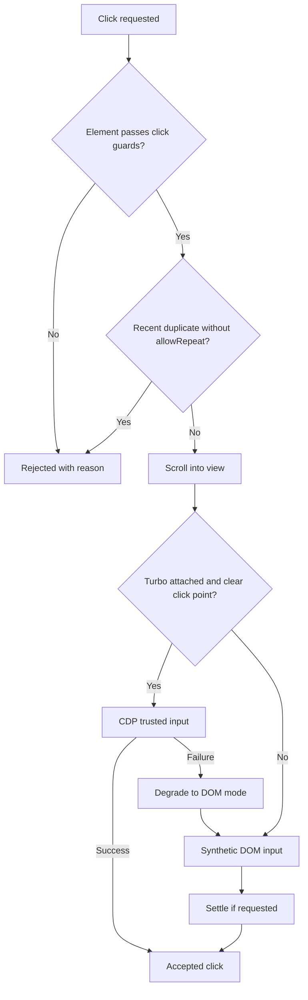

Turbo preference attempts debugger attachment; attachment/command failure permits DOM fallback. Mutation-driven waits have timeouts. Click acceptance and network settling do not themselves prove transaction success. Source: driver.js, cdp-bridge.js.

| Service action | Flow and outcome |
|---|---|
| serverGet | Fetch URL → parse JSON → HTTP ok/status/data or caught error |
| uploadMedImage | Fetch image with cookies → PUT bytes to localhost → HTTP result/error |
| putMedicationDb | PUT JSON DB to localhost → HTTP result/error |
| downloadJson | JSON data URL → Chrome Save As download → download ID/API error, not completion |
| downloadMedImage | Download the supplied URL with its own filename; return download ID or error |
| CDP messages | Attach/debugger input/evaluation/network tracking → result or error |
| Page hook/API client | MAIN-world request observation → capture authentication and request metadata → API calls; also model diagnostics/recording support |

page-hook.js loads at document_start; other manifest content modules at document_idle. These support services are not scheduled jobs.

## 12. HM workstation: inactive and unfinished

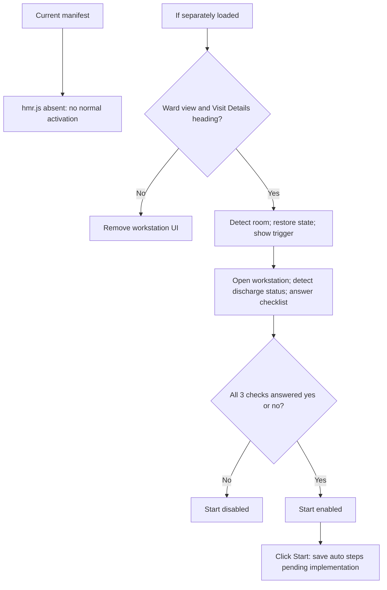

Checklist completeness, not all-Yes, enables Start. Existing incomplete room state can reopen the workstation. Reset creates fresh room state. No actual automated HM steps exist. Source: hmr.js:155–218, hmr.js:284–380; manifest.json.

## Status interpretation and upgrade baseline

| Current signal | What it actually establishes |
|---|---|
| Workbench success | Operation returned to workbench/readiness path |
| IP Fill Done | Selected ward loop finished, even with failed/skipped wards |
| Image success | Server upload or browser download trigger; DB marking is best effort |
| Scraper Completed | Loop/export ended, potentially with error records or partial data |
| Downloaded JSON | Download request accepted or page download triggered |
| Stop | Cooperative flag checked by loops/waits, not rollback of completed actions |

Priority findings:
1. Centralize alert handling so shared close/viewed helpers respect the allergy exclusion before acting.
2. Verify actual committed outcomes, especially IP Fill confirm and post-alert re-confirmation.
3. Strengthen identity: semi-auto index fallback, first-option ward fallback and fixed-column status checks.
4. Add explicit partial/skipped/failed results and 500-loop termination status.
5. Define cross-module ownership and bounded retry rules; persistent auto row failures can be selected repeatedly.
6. Verify image file completion and DB write outcomes before marking success.
7. Keep internal version labels aligned with manifest 4.7.0 and document HMR as inactive.

These are code-review findings; workflow source was not changed.

