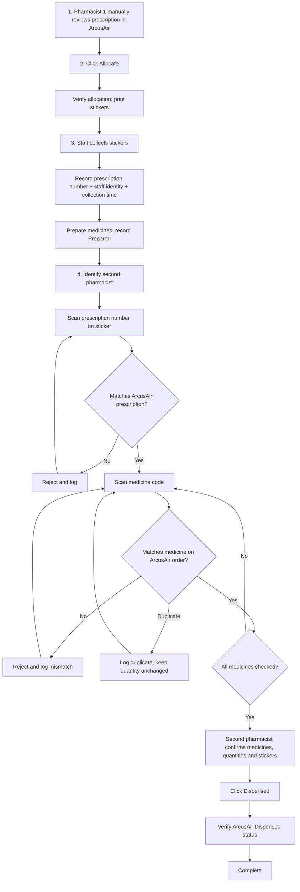

# Paperless checker — reviewed workflow

Open [index.html](index.html) in Chrome. This is a standalone interactive demo with fictional data. ArcusAir actions, printing, and medicine comparison are simulated.

## Four steps

1. **First pharmacist reviews the prescription directly in ArcusAir.** The prescription is already displayed at https://arcusair.bdms.co.th/#!/pharmacy/dispenseworkbench/pharmacy/dispense. No initial prescription scan and no separate overlay review-confirmation button.
2. **First pharmacist clicks Allocate; stickers print.** The demo Allocate button represents the ArcusAir button. Production must observe the selected prescription and verified allocation outcome. Print initiation and verified print completion must be distinguished where printer confirmation is unavailable.
3. **Staff collects stickers and prepares medicines.** Proposed new UI: a sticker-collection form with prescription number and staff identity. Submit records who took the sticker set and when. The preparation card then shows the collector and prescription; Prepared sends it to the second pharmacist.
4. **Second pharmacist checks medicines and stickers.** Identify the second pharmacist, scan the prescription number on the sticker, match the ArcusAir prescription, then scan medicine codes against that order. Check quantities and stickers visually, then explicitly click Dispensed. Workflow ends after verified dispensing.

No separate handover step.

## Try the demo

- Review the selected fictional prescription; click **Allocate**.
- Enter preparation staff ID (for example STAFF-001); click **Record sticker collection**.
- Click **Prepared**.
- Enter second pharmacist ID PHARM-002, different from the first pharmacist.
- Scan RX-DEMO-042, then MED-A and MED-B, using the sample buttons or the input field plus Enter.
- Confirm the medicine/sticker check; click **Dispensed**.
- Export audit JSON. Try wrong or duplicate codes and the uncertain-result option.

## Proposed preparation record and data flow

Prescription number is the lookup key. Each record includes:
- prescriptionNumber, patient/visit context and ArcusAir internal order ID when available;
- firstPharmacist and allocation outcome/time;
- preparationStaff, stickersCollectedAt, preparedAt;
- secondPharmacist, prescription match, item-check events and dispensing outcome/time.

Collection UI → validate prescription and allocation → save staff collection event keyed by prescription number → show Preparing with collector → record Prepared → second checker retrieves the same prescription record.

Production: use BKNData → BKN_SERVER_PROXY → pharmacy server for durable writes. Record collection successfully before showing ownership. Use a server-side atomic claim to avoid two workstations collecting the same prescription unnoticed. Reassignment or reprints should add history rather than replace the original collection. Verify whether prescription numbers are globally unique; retain facility/order identifiers to distinguish collisions while keeping prescription number as the staff lookup key.

The demo exports a prescriptions object keyed by prescription number and timestamped events with staff roles. It has no server persistence or authenticated identities. Reload clears its data. The entered second pharmacist ID must differ from the first; actual role validation requires staff identity integration.

## Flowchart

Every action, scan outcome, staff transition, and automation result has an audit event. Uncertain automation results require reconciliation before continuing. The demo supports simulated successful reconciliation; production must handle verified failure and partial allocation/printing independently.

## Integration boundary

Automate supplies reusable allocation/dispensing mechanics. Initial clinical review remains manual in ArcusAir; the overlay observes allocation and supports preparation tracking and the second check. Existing Automate batch iteration must be adapted to operate on the matched prescription only. Before Dispensed, re-read the ArcusAir order and invalidate checks if its contents or status changed. Live integration is not part of this demo.

